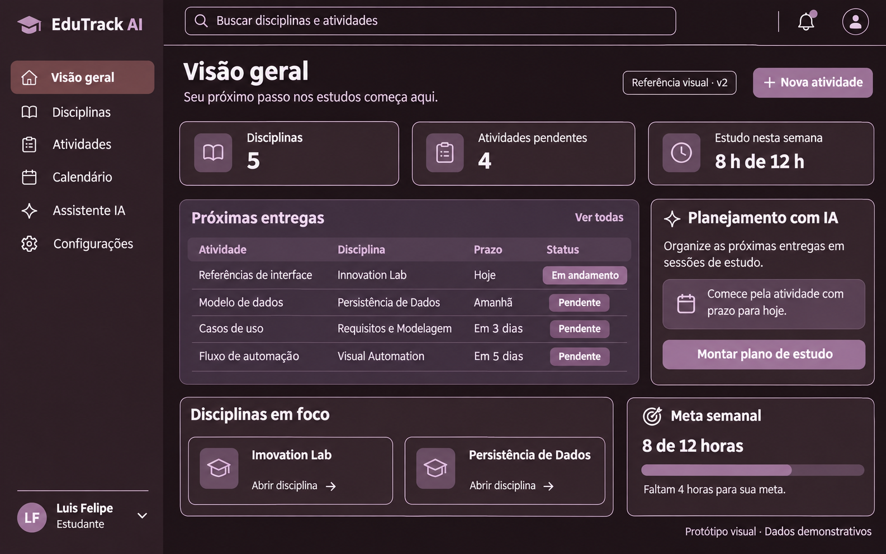
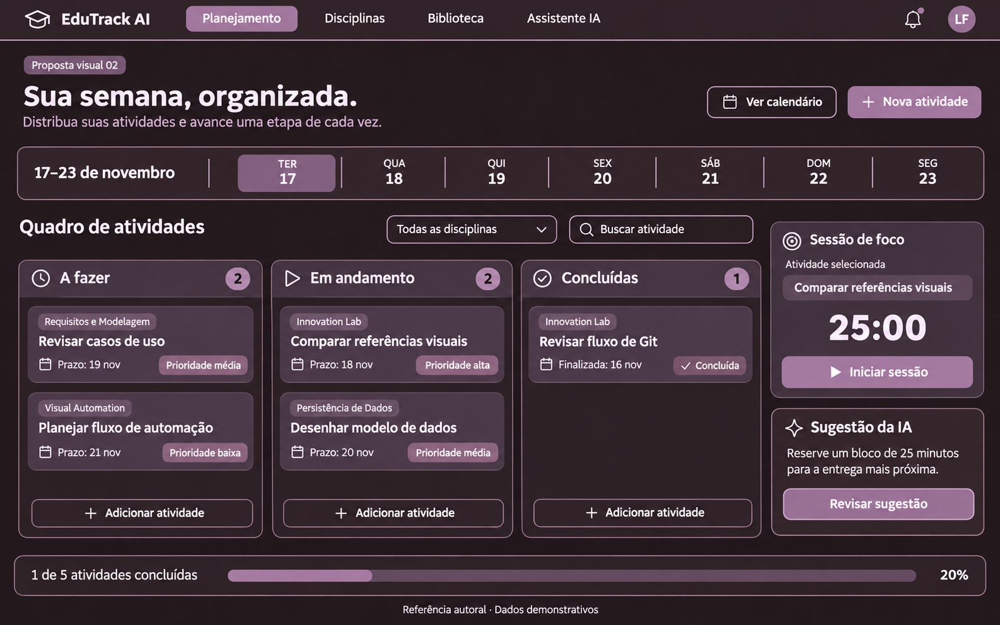

# Tarefa 06 — Referências visuais do EduTrack AI

## 1. Objetivo da pesquisa

Registrar e comparar duas propostas de interface para orientar a organização visual do EduTrack AI. A análise considera a hierarquia das informações, a navegação e a distribuição dos componentes destinados ao acompanhamento acadêmico e ao planejamento dos estudos.

O objetivo é reunir referências para decisões futuras de interface. As observações deste documento se limitam às imagens fornecidas; não constituem validação de usabilidade ou levantamento de produtos externos.

## 2. Origem das referências

As duas propostas são autorais, geradas com auxílio de inteligência artificial nesta atividade. Os arquivos utilizados são:

- `img/template-dashboard-dark.png`: painel acadêmico em tema escuro.
- `img/template-planner-dark.png`: planejamento semanal em tema escuro.

As imagens apresentam dados demonstrativos. Nomes de atividades, disciplinas, datas, quantidades, percentuais e horas ilustram a composição visual e não representam resultados medidos no EduTrack AI.

## 3. Template 1 — Painel acadêmico

### Organização dos componentes

- **Navegação lateral:** reúne Visão geral, Disciplinas, Atividades, Calendário, Assistente IA e Configurações, com identificação do estudante na parte inferior.
- **Barra superior:** apresenta busca por disciplinas e atividades, notificações e acesso ao perfil.
- **Cabeçalho e indicadores:** combina o título da página e a ação Nova atividade com cartões de disciplinas, atividades pendentes e horas de estudo na semana.
- **Próximas entregas:** organiza atividade, disciplina, prazo e status em uma tabela central, permitindo comparar visualmente os compromissos apresentados.
- **Planejamento com IA:** reserva uma área para uma sugestão de prioridade e para a ação Montar plano de estudo.
- **Disciplinas em foco e meta semanal:** oferece cartões de acesso às disciplinas e uma barra de progresso das horas de estudo.

### Utilidade para o EduTrack AI

A proposta pode orientar uma página inicial que reúna o panorama acadêmico em um único lugar. A tabela de entregas destaca prazos; os cartões de disciplinas oferecem acesso direto aos assuntos; e a meta semanal relaciona o tempo de estudo a um objetivo. Essa organização sugere uma sequência de consulta: identificar pendências, observar a entrega mais próxima e escolher o próximo estudo.

Na imagem, os valores de cinco disciplinas, quatro atividades pendentes e oito de doze horas de estudo são exemplos visuais, não dados da aplicação em funcionamento.

## 4. Template 2 — Planejamento semanal

### Organização dos componentes

- **Navegação superior:** reúne Planejamento, Disciplinas, Biblioteca e Assistente IA, além de notificações e perfil.
- **Cabeçalho e ações:** apresenta a orientação da página e os botões Ver calendário e Nova atividade.
- **Calendário semanal:** exibe uma faixa horizontal de 17 a 23 de novembro, com um dia destacado, como referência para distribuir atividades ao longo da semana.
- **Filtros e busca:** posiciona a seleção de disciplina e a busca de atividade acima do quadro.
- **Quadro Kanban:** divide as atividades em A fazer, Em andamento e Concluídas. Os cartões mostram disciplina, título, prazo ou data de conclusão e etiquetas de prioridade ou estado. As colunas também apresentam contadores e ações para adicionar atividades.
- **Sessão de foco:** apresenta a atividade selecionada, um cronômetro ilustrativo de 25 minutos e a ação Iniciar sessão.
- **Sugestão da IA e progresso:** reserva um cartão para uma recomendação de estudo e uma barra inferior para o acompanhamento das atividades concluídas.

### Utilidade para o EduTrack AI

A proposta pode orientar uma área dedicada à execução do planejamento. O calendário situa os compromissos no tempo, o Kanban separa as etapas das atividades e a sessão de foco aproxima uma tarefa selecionada de um período de estudo. A busca e o filtro sugerem formas de reduzir a quantidade de informações exibidas conforme a disciplina de interesse.

O quadro ilustra duas atividades a fazer, duas em andamento e uma concluída, com progresso de 20%. O cronômetro, os estados dos cartões e esse percentual são representações estáticas; a imagem não demonstra movimentação de cartões, contagem de tempo ou atualização automática.

## 5. Comparação e orientação para o EduTrack AI

| Aspecto | Painel acadêmico | Planejamento semanal |
| --- | --- | --- |
| Ênfase | Visão geral de disciplinas, pendências e metas. | Organização e acompanhamento das atividades da semana. |
| Componente central | Tabela de próximas entregas, apoiada por indicadores. | Quadro Kanban, apoiado por calendário e filtros. |
| Navegação | Menu lateral persistente. | Menu horizontal no topo. |
| Acompanhamento de progresso | Horas estudadas em relação à meta semanal. | Atividades concluídas em relação ao total exibido. |
| Espaço reservado à IA | Sugestão de prioridade e montagem de plano de estudo. | Sugestão de um bloco de estudo associado à entrega mais próxima. |
| Possível papel no produto | Página inicial para consultar a situação acadêmica. | Área de planejamento e execução de tarefas. |

As propostas podem ser complementares: o painel como ponto de entrada e o planejamento semanal como uma área acessada a partir dele. A tabela de entregas pode orientar a escolha de uma atividade; o quadro semanal pode orientar seu acompanhamento por etapa.

Para combinar essas referências, o EduTrack AI precisaria adotar uma navegação consistente, padronizar nomes de estados e prioridades e manter a mesma identidade visual nos cartões e nas ações. Os dois menus das imagens são alternativas de composição, não uma decisão de usar dois padrões diferentes no produto.

Essa combinação é uma hipótese de projeto baseada na leitura visual das propostas. A escolha final e eventuais benefícios de uso ainda precisariam ser avaliados em um protótipo interativo e com usuários.

## 6. Paleta original e adaptação ao tema escuro

| Cor original | Intenção visual | Papel pretendido |
| --- | --- | --- |
| `#694545` | 60% | Cor de base para a estrutura, os fundos e as áreas de maior extensão. |
| `#D5B2DC` | 30% | Cor secundária para apoiar a hierarquia e diferenciar áreas e informações. |
| `#A782AD` | 10% | Cor de destaque para ações principais, seleções e pontos de atenção. |

As proporções de 60%, 30% e 10% expressam uma intenção de distribuição visual da paleta original. **Essas proporções não foram medidas nas imagens** e não devem ser interpretadas como percentuais comprovados de pixels ou de área ocupada.

O tema escuro usa variações tonais dessa paleta: fundos mais escuros, superfícies intermediárias e tons mais claros em textos, contornos e destaques. Por isso, os três códigos originais funcionam como referência de identidade visual, não como uma lista exaustiva das cores presentes nas imagens.

Não foi realizada medição de contraste ou avaliação de acessibilidade. Legibilidade, contraste dos estados e uso de cor em conjunto com texto e ícones deverão ser verificados na implementação da interface.

## 7. Referências visuais e funcionalidades implementadas

Este documento registra referências visuais e possibilidades de organização da interface. A presença de busca, notificações, calendário, Kanban, cronômetro, metas ou sugestões de IA nas imagens não comprova que esses recursos estejam implementados ou conectados ao backend.

Os rótulos e botões indicam intenções de interação. Também não comprovam arrastar e soltar cartões, persistência de dados, geração de planos por IA ou funcionamento das sessões de foco. O estado de implementação de cada recurso deve ser confirmado separadamente no código e em testes específicos.

Nesta atividade de documentação, foram inspecionadas as duas imagens e conferidos os caminhos relativos usados no Markdown. Não foram realizados testes de usabilidade, acessibilidade, responsividade ou desempenho, nem pesquisa em catálogos externos de templates.
